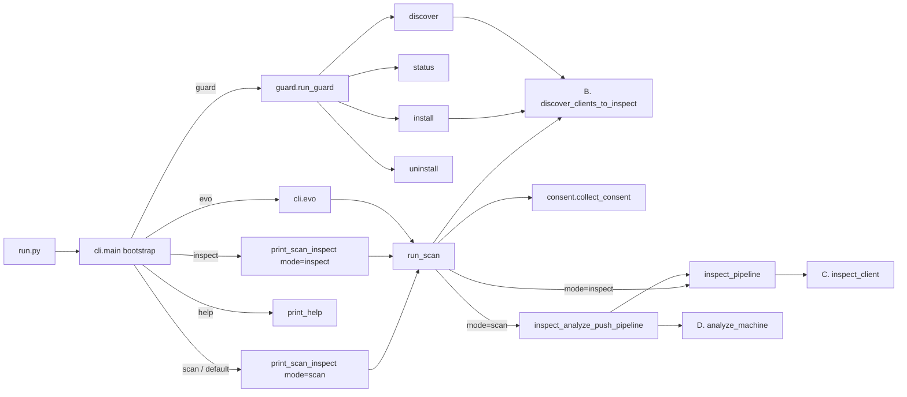

# CLI execution flows (reverse-engineered)

Sequence diagrams for every command of `snyk-agent-scan` v0.6.9, derived from the source in `src/agent_scan`. Every diagram groups its participants into the same three layers so the split of responsibilities is visible:

| Layer | Meaning | Typical participants |
|-------|---------|----------------------|
| **User** | Terminal I/O and the host coding agent | stdin / stdout / stderr, Claude Code, Cursor, ... |
| **Flow logic** | Python code in `agent_scan` that decides what happens | `cli.py`, `pipelines.py`, `inspect.py`, `consent.py`, `redact.py`, `verify_api.py`, `guard.py` |
| **Client machine resources** | Anything touching the local machine | filesystem, env / OS, SQLite, subprocesses (stdio MCP servers, `codesign`, hook scripts) |
| **Backends** | Anything on the network | remote MCP servers, Snyk analysis API, Snyk Platform API, Agent Monitor |

Diagrams are Mermaid (render on GitHub and most Markdown viewers). All of them were parse-checked with Mermaid 11.

## Commands

| Command | Purpose | Diagram |
|---------|---------|---------|
| `scan` (default) | Discover, inspect, analyze, print risks | [scan.md](scan.md) |
| `inspect` | Discover and inspect, print raw tool / skill catalog, no backend analysis | [inspect.md](inspect.md) |
| `evo` | Mint push key, scan, revoke push key | [evo.md](evo.md) |
| `help` | Print help | [help.md](help.md) |
| `guard` (no sub-command) | Show installed Agent Guard hooks | [guard-status.md](guard-status.md) |
| `guard install` | Deploy hook scripts, rewrite agent hook config, send test + discovery events | [guard-install.md](guard-install.md) |
| `guard uninstall` | Remove hooks and scripts, revoke push key | [guard-uninstall.md](guard-uninstall.md) |
| `guard discover` | Session-start hook entry point: discover servers, send one event | [guard-discover.md](guard-discover.md) |

Supporting material:

| File | Content |
|------|---------|
| [shared-subflows.md](shared-subflows.md) | A. CLI bootstrap, B. Discovery, C. Inspection, D. Analysis request |
| [guard-hook-runtime.md](guard-hook-runtime.md) | What the installed hook script does on each agent event (not a CLI command) |

## Command map at a glance

## Where each kind of work lives

| Kind of work | Where it happens today | Flows that use it |
|--------------|------------------------|-------------------|
| Argument parsing, config-file merge, defaults, safety rules | `cli.py` | all |
| Locating home dirs, agents, configs, skills, project roots | `pipelines.py`, `inspect.py`, `well_known_clients.py`, `agents/*` | scan, inspect, evo, guard install, guard discover |
| SQLite | only `agents/opencode.py` (read-only project list) | the same flows, through discovery |
| Starting / talking to MCP servers | `inspect.py`, `mcp_client.py`, `traffic_capture.py` | scan, inspect, evo |
| Consent decision and prompts | `cli.decide_handshake`, `consent.py` | scan, inspect (evo and push-key scans skip it) |
| Redaction | `redact.py`, called from `skill_client.py`, `pipelines.py`, `models/api/v20260710.py`, `agents/claude_desktop.py` | scan, inspect, evo, guard |
| Request building and auth selection for the analysis API | `verify_api.py` | scan, evo |
| Push key lifecycle | `pushkeys.py`, `cli.evo`, `guard.py` | evo, guard install, guard uninstall |
| Hook config editing (4 formats) and script deployment | `guard.py`, `hooks/*` | guard |
| Hook event delivery | `hooks/snyk-agent-guard.sh/.ps1` (curl) and `hook_events.py` (aiohttp) | guard install, guard discover, runtime hooks |
| Rendering and CI verdict | `printer.py`, `cli._handle_ci_exit` | scan, inspect |

## Cross-cutting findings (candidates for realignment)

These are observations from tracing the code, ordered roughly by impact on further development.

1. **Two discovery engines run side by side.** `get_mcp_config_per_client` (static OS tables in `well_known_clients.py`) and the `AgentDiscoverer` classes (`agents/*`) both discover the same agents, then `pipelines.discover_clients_to_inspect` merges the results (phase B wins on identical keys). Behavior depends on which engine knows about a path, and stdio signature checks (`codesign`) can run twice. See [flow B](shared-subflows.md#b-discovery-discover_clients_to_inspect).
2. **"Discovery" performs more than reading files.** It spawns `codesign`, runs `powershell` / `wsl.exe` for `--scan-all-users`, and opens SQLite, all inside what is described as the no-side-effects phase. There is no I/O boundary object; `pathlib` / `os` / `subprocess` calls are spread across `pipelines.py`, `inspect.py`, `signed_binary.py`, `utils.py`, `agents/*`.
3. **Command-specific behavior is encoded as `command == "evo"` / `"inspect"` string checks inside shared helpers** (`_effective_push_key`, `is_interactive_run`, `decide_handshake`, `_should_show_analysis_results`). Behavior of one command is changed by editing logic that all commands share.
4. **`evo` bypasses the presentation path.** It calls `run_scan` directly and discards the result, so results are never printed; there is no `try/finally` around the minted push key; exit code is 0 even when minting fails. See [evo](evo.md).
5. **Arguments that do nothing or do something other than documented.** `--storage-file`, `--checks-per-server`, `--no-bootstrap` are unused. `--control-server URL` is documented as "upload scan results", but the URL is never requested: only its `x-client-id` header (push key) and identifier are used, and `X-Push: skip` is sent to the analysis API. `inspect` registers the control-server / push-key options and ignores them. `--test` for `guard install` is a no-op. `help` carries dead branch logic.
6. **Four HTTP stacks, three retry policies.** `aiohttp` (analysis, hook events), `urllib` (push-key and guard-enabled calls), `httpx` via `mcp` (MCP servers), `curl` in shell scripts (hooks). Retries: synchronous analysis retries only `TimeoutError`, async analysis and config calls retry 5xx and connection errors, hook events retry transport errors only, `urllib` calls do not retry. The wire contract for hook events exists twice (Python and shell / PowerShell).
7. **Auth routing by string replacement.** `verify_api.analyze_machine` picks the endpoint by rewriting the URL path (`analysis-machine` -> `cli/analysis-machine`, `config`, `async/analysis`) depending on push key / `SNYK_TOKEN` / `SNYK_CLI_USE`. A transport function owns routing decisions. A non-200 2xx response would leave `error_text` unbound in the retry loop.
8. **Sequential inspection.** Clients, servers and (up to 6) remote URL candidates are tried one after another; total runtime is the sum of timeouts.
9. **Redaction in three places.** Skill files at read time (`skill_client`), config and errors after inspection (`redact_inspected_path`), and again on the deep-copied request (`models/api/v20260710.py`). Which pass protects what is not obvious from any single module.
10. **`guard.py` is a monolith** (2100+ lines): CLI handling, prompts, four hook file formats (JSON, flat JSON, Copilot JSON, Codex TOML), diffing, script deployment, subprocess invocation, event payload building, and discovery. Install state is stored inside hook command text and recovered with regexes.
11. **`guard discover` reaches into private helpers.** `_servers_discovered_entries` imports `_config_error_to_scan_error`, `_inspection_component_name`, `_join_scan_errors` from `inspect.py` to build a "not inspected" result, and every hook-triggered run pays for the full CLI bootstrap (parser, banner, logging).
12. **Entry-point mismatch.** `run.py` wraps a synchronous `main()` in `asyncio.run(...)`; it works only because `main()` always exits via `sys.exit`. Interactive prompts are implemented three ways (`input()` in `cli.evo` and `guard`, `sys.stdin.readline` in `consent.py`).
13. **Small duplications.** `get_hostname` / `get_username` in both `utils.py` and `verify_api.py`; `suppress_mcpserver_io` resolved in both `main()` and `run_scan()`; `HOOK_VERSION` read from env at import time.

## Suggested seams (if the goal is a cleaner design)

- A **machine adapter** (filesystem, env, home dirs, SQLite, subprocess, `codesign`) behind one interface, so discovery and guard logic can be tested without touching the real machine.
- A single **discovery engine** (keep the `AgentDiscoverer` classes, generate the static tables from them or delete them).
- A **command object per sub-command** with its own defaults (consent, handshake, output) instead of `command == ...` checks in shared helpers.
- A **backend client module** per service (analysis, platform, agent-monitor) with one HTTP stack and one retry policy; auth selection as data, not URL rewriting.
- Split **`guard.py`** into config-format adapters (one per agent), script deployment, and the install / uninstall / discover use cases.
