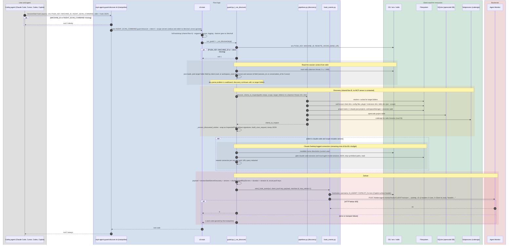

# `guard discover`

`snyk-agent-scan guard discover --client {claude-code|cursor|codex|github-copilot} [--scope servers|skills|all] [--url URL]`

Not intended for humans: it is the command that the **session-start hook** installed by `guard install` runs (asynchronously) when an agent session begins. It discovers the MCP servers visible from the session's working folders and sends one `sessionStartServerDiscovery` event directly to Agent Monitor.

Required environment (set by the generated hook command): `PUSH_KEY`, `MACHINE_ID`, optionally `REMOTE_HOOKS_BASE_URL`. Required stdin: the agent's hook JSON payload (read with a 5 s timeout, 1 MiB cap).

Entry points: `snyk-agent-guard-discover.{sh,ps1}` -> `cli.py:main` -> `guard.run_guard` -> `guard._run_discover` -> `guard._send_servers_discovered_event`.

## Sequence diagram

## Notes

- A full CLI start-up (argparse tree, optional config file, banner, logging setup, psutil lookup of the parent process) runs for every agent session start, only to dispatch to one function. `guard` is imported lazily, but the generic bootstrap is not skipped.
- Discovery here reuses `pipelines.discover_clients_to_inspect`, then re-implements the "inspect without contacting servers" step by importing private helpers from `inspect.py` (`_config_error_to_scan_error`, `_inspection_component_name`, `_join_scan_errors`) and `verify_api.build_scan_request`.
- Same hand-off style as install: the push key travels via environment variables defined inside the hook command text; the CLI never reads the agent config.
- The wire contract (base64 body, `X-User`, `X-Client-Id`) is implemented twice: in `hook_events.py` (Python) and in `snyk-agent-guard.sh` / `.ps1` (see [guard hook runtime](guard-hook-runtime.md)).
