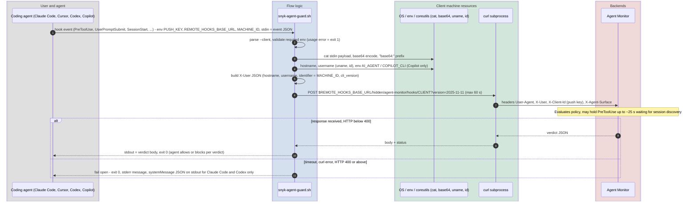

# Guard hook runtime (supporting flow, not a CLI sub-command)

After `guard install`, every hook event of the agent runs `src/agent_scan/hooks/snyk-agent-guard.sh` (or `.ps1` on Windows). The Python CLI is **not** involved at this point; the script is a thin forwarder to Agent Monitor and the verdict logic lives entirely in the backend. It is documented here because it shares the wire contract with `guard install` (test event) and `guard discover`.

## Sequence diagram

## Notes

- Fail-open is implemented in the shell script, per client output schema (Cursor and Copilot get an empty stdout).
- `guard install` verifies the same script by running it once with a `hooksConfigured` payload and requiring `"success": true` in the response body (the server answers HTTP 200 even for an invalid push key).
- `snyk-agent-guard.ps1` mirrors the bash logic for Windows; both carry an "install-time variables" section that `guard install` fills with the CLI version.
