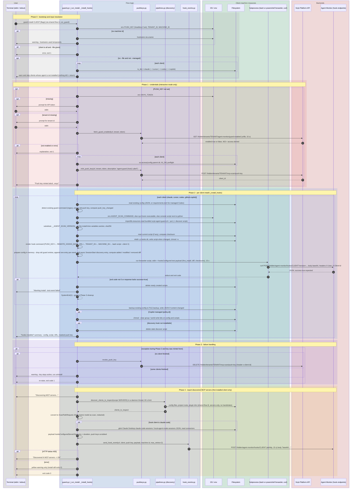

# `guard install`

`snyk-agent-scan guard install {claude|cursor|codex|github-copilot|all} [--url URL] [--tenant-id ID] [--machine-id ID] [--file PATH] [--managed]`

Installs Agent Guard hooks into the selected coding agent(s): copies the forwarder shell / PowerShell scripts next to the agent's config, rewrites the agent's hook config so every hook event is piped through the forwarder, verifies the setup with a test event, and reports the MCP servers found on the machine.

Entry points: `cli.py:main` -> `guard.run_guard` -> `guard._run_install` -> `guard._install_hooks` (per client) -> `guard._send_servers_discovered_event`.

Two credential modes:

- **Interactive** (no `PUSH_KEY` env): needs `SNYK_TOKEN` (env or typed) and a tenant id; the command mints a push key and revokes it again if the install fails before anything was written.
- **Headless / MDM** (`PUSH_KEY` env set): no Snyk token, no tenant lookup, no minting.

## Sequence diagram

## Files touched on the client machine

| Resource | Path (user scope) | Managed scope (`--managed`) | Access |
|----------|-------------------|-----------------------------|--------|
| Claude Code settings | `~/.claude/settings.json` | OS-specific `managed-settings.json` | read, backup, write |
| Cursor hooks | `~/.cursor/hooks.json` | OS-specific `hooks.json` | read, backup, write |
| Codex hooks | `~/.codex/hooks.json` | `/etc/codex/requirements.toml` (re-rendered from scratch) | read, backup, write |
| Copilot hooks | `~/.copilot/hooks/snyk-agent-guard.json` | `/etc/github-copilot/policy.d/snyk-agent-guard.json` | read, backup, write, chmod |
| Forwarder scripts | `<config dir>/hooks/snyk-agent-guard.{sh,ps1}`, `snyk-agent-guard-discover.{sh,ps1}` | same | write, chmod +x |
| Backups | `<config file>.backup` | same | copy |

## Observations

- `guard.py` (2100+ lines) holds argument handling, credential prompts, four different config file formats, script deployment, diffing and event delivery in one module; each client has its own `_prepare_*_config` / `_filter_*_hooks` / `_detect_*_install` triple.
- The install state is stored **in the hook command text** (push key, URL, tenant id as `KEY='value'` prefixes) and recovered by regex.
- Two transports to the same backend: the test event goes through the shell forwarder (`bash` + `curl`) in a subprocess, the discovery event through in-process `aiohttp`.
- The discovery event is sent for the **first installed client only**, even for `install all`, although the payload describes every agent on the machine.
- `--test` is accepted and ignored. `all` with `--managed` skips the "is the agent installed" check.
- Secrets handling: the push key appears in the hook command line (visible in the agent's config and in process environment of every hook run), and is masked in all console output.
