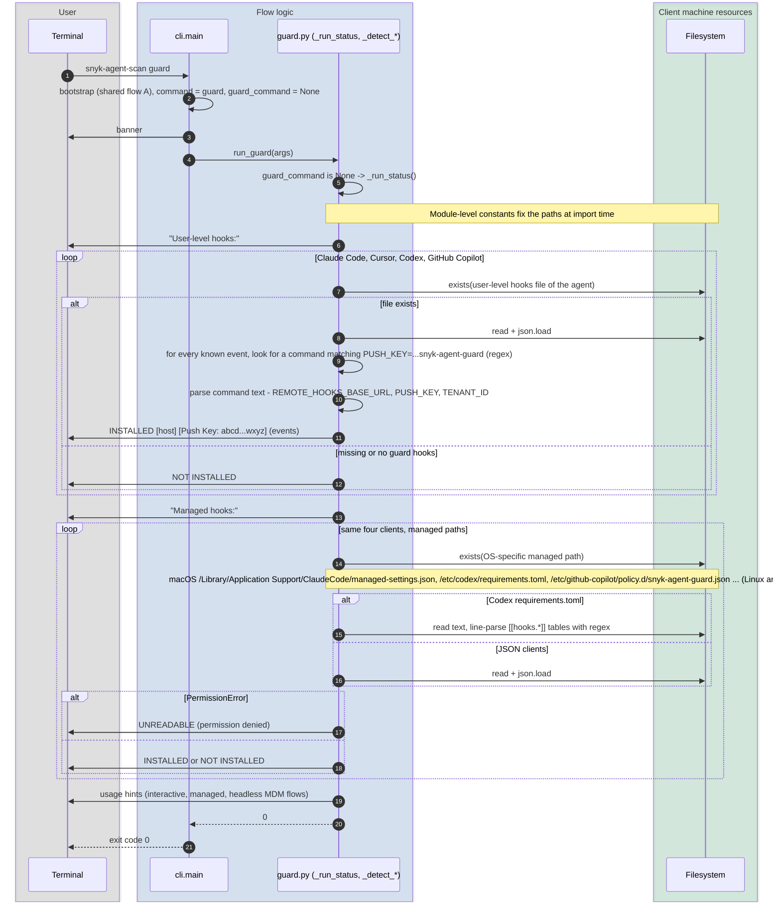

# `guard` (no sub-command) - status

`snyk-agent-scan guard`. Shows whether Agent Guard hooks are installed for Claude Code, Cursor, Codex and GitHub Copilot, at user level and at managed (admin / MDM) level. Purely local and read-only.

Entry points: `cli.py:main` -> `guard.run_guard` -> `guard._run_status`.

## Sequence diagram

## Notes

- No backend is contacted. The push key is shown masked (first 4 / last 4 characters).
- Detection is text matching on the stored hook command (`_DETECTION_RE`), not a registry of installs. The installed command line therefore doubles as the persistence format for push key, URL and tenant id (also used later by [`guard uninstall`](guard-uninstall.md) to revoke the key).
- A malformed JSON file or a `PermissionError` on a **user-level** path is not handled in `_run_status`; it is caught by `run_guard`, which prints an error and returns exit code 1 for the whole command. Only managed paths get per-file `PermissionError` handling.
