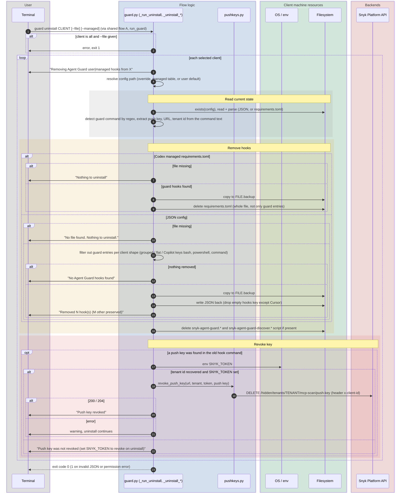

# `guard uninstall`

`snyk-agent-scan guard uninstall {claude|cursor|codex|github-copilot|all} [--file PATH] [--managed]`

Removes Agent Guard hooks from the selected agent config(s), deletes the forwarder scripts and, when it can, revokes the push key that was stored in the hook command.

Entry points: `cli.py:main` -> `guard.run_guard` -> `guard._run_uninstall` -> `guard._uninstall_single_client` (per client).

## Sequence diagram

## Notes

- Uninstall is the inverse of the install, but it is **not** symmetrical in what it needs: it recovers the push key / tenant id by parsing the previously written hook command, so a config edited by hand can lose the ability to revoke.
- The Codex managed variant deletes the whole `requirements.toml` (backup first), while install re-renders the whole file; any non-Agent-Guard content in that file is not preserved in either direction.
- With `--managed` the revoke step still depends on the *current user's* `SNYK_TOKEN`; headless MDM uninstalls without a token leave the key active.
- `PermissionError` while reading a managed path aborts the run with exit code 1 (no per-client recovery, unlike `guard` status).
