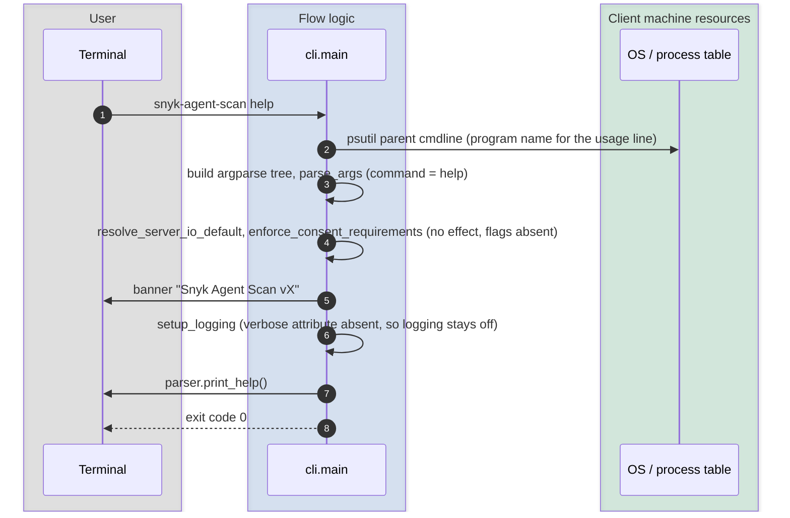

# `help`

`snyk-agent-scan help`. Prints the argparse help text and exits. No scanning, no network, no filesystem access beyond the optional config file.

Related spellings: `snyk-agent-scan --help` alone is handled inside `argparse` itself and exits **before** the banner and before any code in `main()` after `parse_args()` runs; `snyk-agent-scan <command> --help` is also argparse-internal.

## Sequence diagram

## Notes

- `help` is registered as a sub-parser without any arguments, so `--config-file` and the other common flags are not accepted for it.
- The second branch of the dispatch condition, `args.command is None and hasattr(args, "help")`, can never be true because `main()` always injects `scan` when no command is given. It is dead code.
- The banner is printed before the help text for the `help` sub-command only, not for `--help`.
