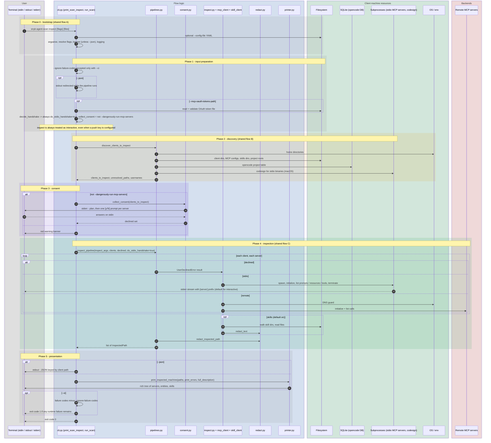

# `inspect`

`snyk-agent-scan inspect [CONFIG_FILE ...]`. Prints the tools, prompts, resources and skill files found on the machine **without** calling the Snyk analysis backend.

Entry points: `cli.py:main` -> `print_scan_inspect(mode="inspect")` -> `run_scan(mode="inspect")` -> `pipelines.inspect_pipeline`.

Difference to [`scan`](scan.md): same bootstrap, discovery, consent and inspection; the analysis step (shared flow D) is skipped, nothing leaves the machine except the traffic to the MCP servers themselves, and the output is the raw `InspectedPath` list.

## Sequence diagram

## What is *not* in this flow

- No call to `verify_api.analyze_machine`: no `SNYK_TOKEN`, push key, hostname / username collection, or request payload is built.
- No second redaction pass (only `redact_inspected_path` plus skill-file redaction), so what is printed is exactly what `scan` would have sent for the same servers, after local redaction.
- Risk scoring and the `--ignore-risks` option do not exist here (`--ci` can only fail on runtime failures).

## Notes

- `inspect` registers `add_control_server_arguments` (`--control-server`, `--push-key`, `--machine-id`), but none of them has an effect in this mode.
- The consent and handshake logic is the same shared code as `scan`, so any change to server contact rules affects both.
