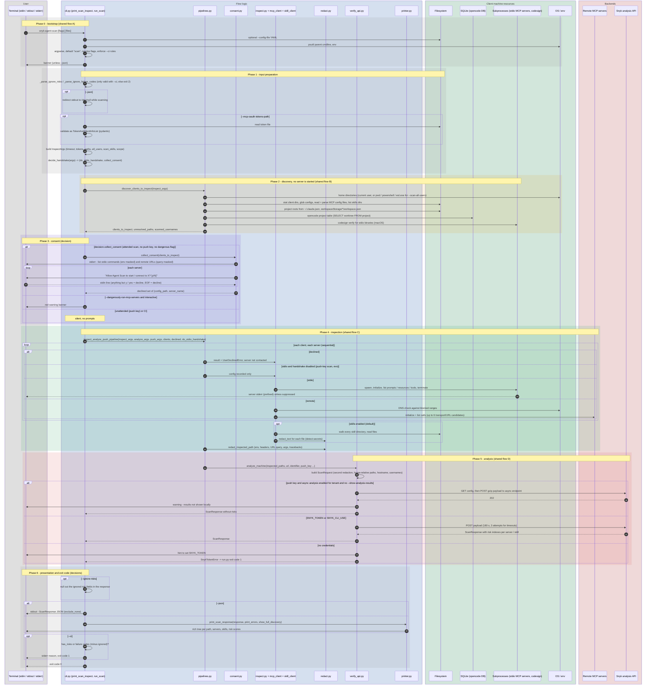

# `scan` (default command)

`snyk-agent-scan [scan] [CONFIG_FILE ...]`. Running the binary without a sub-command is rewritten to `scan` (see [A. CLI bootstrap](shared-subflows.md#a-cli-bootstrap)).

Entry points: `cli.py:main` -> `print_scan_inspect(mode="scan")` -> `run_scan` -> `pipelines.inspect_analyze_push_pipeline`.

What it does: discover MCP configs and skills on the machine, optionally start / contact each MCP server to read its tool catalog, redact secrets, send everything to the Snyk analysis API and render the returned risk scores.

## Sequence diagram

## Decision table: `decide_handshake`

| Situation | Start stdio servers | Ask consent |
|-----------|--------------------|-------------|
| `--dangerously-run-mcp-servers` | yes | no |
| no push key (attended) | yes | yes |
| push key (MDM / unattended) | no (remote servers are still contacted, without a prompt) | no |
| `--ci` | requires `--dangerously-run-mcp-servers` | no |

## Where the work happens

| Concern | Layer | Code |
|---------|-------|------|
| Flag merge, default command, CI rules, exit codes | Flow logic | `cli.py` |
| Home dirs, config files, skills, project roots, SQLite, `codesign` | Client machine | `pipelines.py`, `inspect.py`, `agents/*`, `skill_client.py`, `signed_binary.py`, `utils.py` |
| Consent, server start-or-skip decision, error normalization | Flow logic | `cli.decide_handshake`, `consent.py`, `inspect._inspect_server` |
| Talking to MCP servers (stdio / HTTP / SSE) | Client machine + remote MCP | `mcp_client.py`, `traffic_capture.py` |
| Secret redaction | Flow logic | `redact.py` (applied at skill read, after inspection, and again at request build) |
| Risk scoring | Backend | Snyk analysis API (no scoring logic on the client) |
| Rendering and CI verdict | Flow logic | `printer.py`, `cli._handle_ci_exit` |

## Exit codes

- `0` normal completion (even if risks are found, unless `--ci`).
- `1` `--ci` with risks or failure codes, missing `SNYK_TOKEN`, missing control identifier.
- `2` usage errors (`--ci` without `--dangerously-run-mcp-servers`, `--ignore-*` without `--ci`, bad config file).

## Notes specific to `scan`

- `--storage-file`, `--checks-per-server` and `--no-bootstrap` are parsed but unused in code.
- The `--control-server` block is parsed, but the client never contacts that URL: its `x-client-id` header becomes the push key, and the presence of any control server sets `X-Push: skip` on the analysis call.
- `suppress_mcpserver_io` is resolved twice (`main()` and `run_scan()`).
