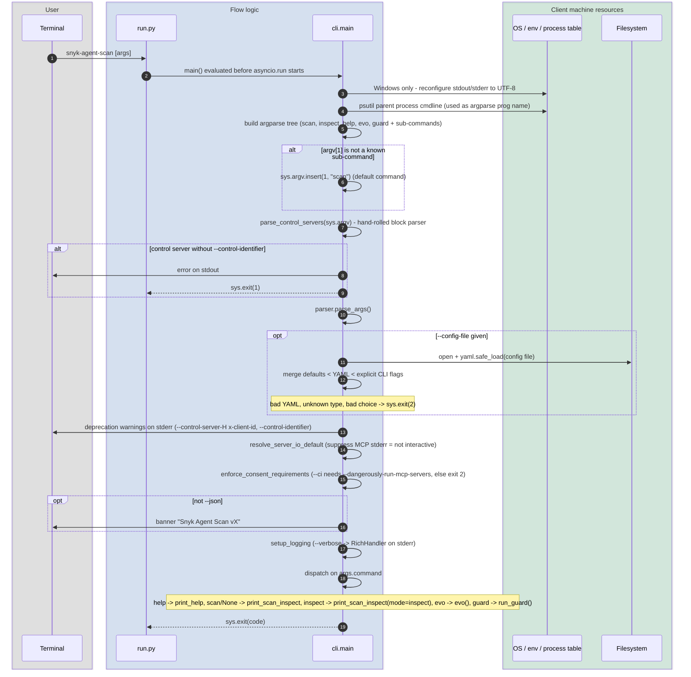
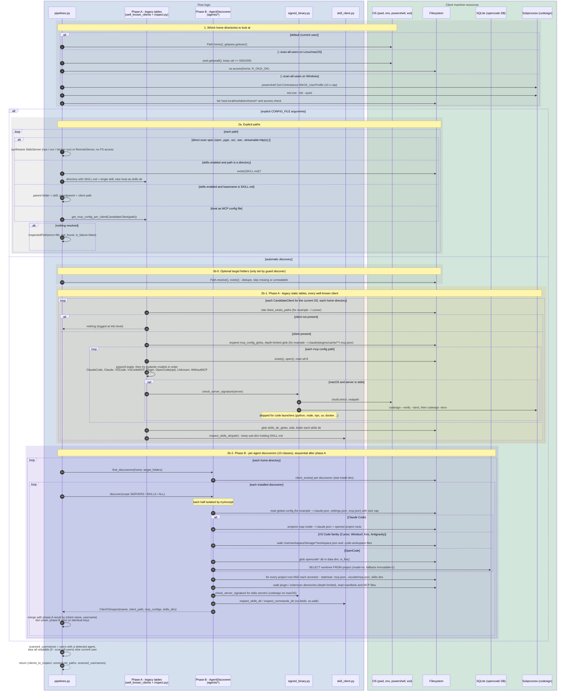
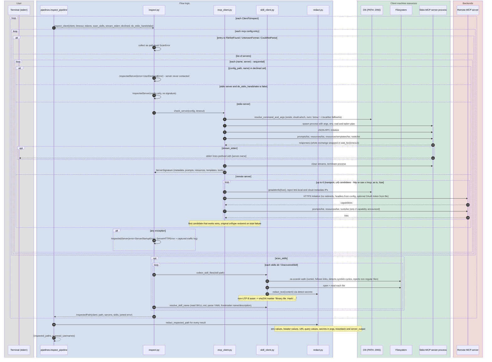
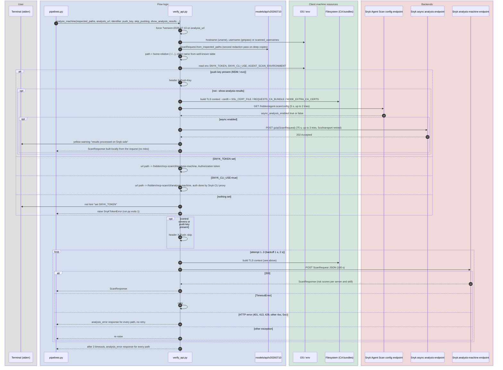

# Shared sub-flows

Building blocks reused by several commands. The per-command files link here instead of repeating them.

| ID | Sub-flow | Used by |
|----|----------|---------|
| A | [CLI bootstrap](#a-cli-bootstrap) | every command |
| B | [Discovery](#b-discovery-discover_clients_to_inspect) | `scan`, `inspect`, `evo`, `guard install`, `guard discover` |
| C | [Inspection](#c-inspection-inspect_client) | `scan`, `inspect`, `evo` |
| D | [Analysis request](#d-analysis-request-analyze_machine) | `scan`, `evo` |

Layer legend (same in every diagram):

- **User** – the terminal (stdin / stdout / stderr).
- **Flow logic** – Python modules inside `agent_scan`.
- **Client machine resources** – filesystem, OS/env, SQLite, local subprocesses.
- **Backends** – remote MCP servers and Snyk services.

---

## A. CLI bootstrap

Source: `run.py`, `cli.py:main` (lines 830-1087).

Observations
- `run.py` calls `asyncio.run(main())` but `main()` is a plain function that always ends in `sys.exit(...)`. It works only because `SystemExit` escapes before `asyncio.run` receives the return value.
- `except (SnykTokenError, MissingIdentifierError)` in `run.py` partly duplicates the handling inside `main()`.

---

## B. Discovery (`discover_clients_to_inspect`)

Source: `pipelines.py:61-162`, `inspect.py:78-221`, `agents/*`, `well_known_clients.py`, `utils.py:277`.
No MCP server is started here, the output is a list of `ClientToInspect` (config files parsed, skills directories listed).

Observations
- Two parallel discovery mechanisms (static tables in `well_known_clients.py` plus the `AgentDiscoverer` classes) run for the same agents and are merged afterwards. Claude Code, VS Code, Cursor, etc. are therefore discovered twice and `check_server_signature` (a `codesign` subprocess) can run twice for the same server.
- Discovery is where almost all client-machine I/O happens. SQLite is used in exactly one place (OpenCode project list).
- `get_hostname()` / `get_username()` exist in both `utils.py` and `verify_api.py`.

---

## C. Inspection (`inspect_client`)

Source: `pipelines.py:165-203`, `inspect.py:234-486`, `mcp_client.py`, `skill_client.py`, `redact.py`.
Runs strictly sequentially: client by client, server by server.

Observations
- No concurrency: a machine with N slow servers costs up to N x `--server-timeout` (and up to 6 x timeout per remote server).
- Redaction happens twice: locally in `inspect_pipeline`, then again on a deep copy when the API request is built (`models/api/v20260710.py`).
- Skill file content is redacted at read time (`skill_client`), config redaction happens later (`redact_inspected_path`) - two different places for the same concern.

---

## D. Analysis request (`analyze_machine`)

Source: `verify_api.py:434-607`.

Observations
- Auth mode is decided by string-rewriting the URL path (`/hidden/mcp-scan/analysis-machine` to `/cli/analysis-machine`, `.../config`, `.../async/analysis`) - routing logic lives inside the HTTP client function.
- Retry policy is inconsistent: the synchronous call retries only `TimeoutError`; 5xx and plain connection errors are not retried, while the async submit and config check retry 5xx and connection errors.
- The deprecated `--control-server` URL is never called by the client. `bool(control_servers)` only sets `X-Push: skip`, and the `x-client-id` header is read as the push key.
